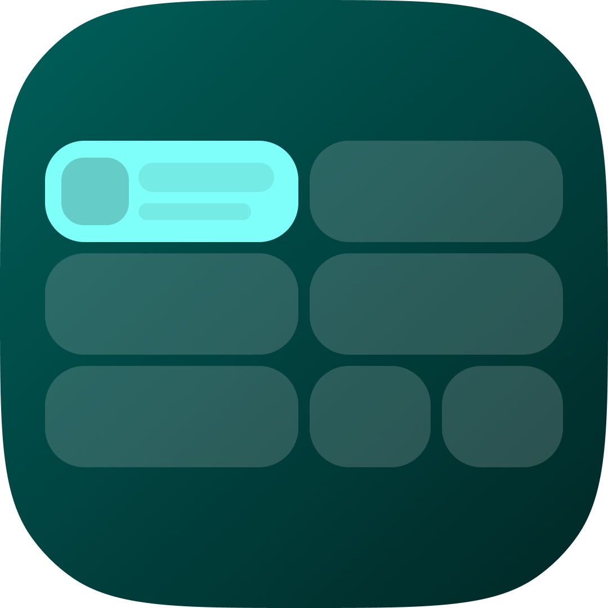

  

# ExpressiveShade

> A next-generation Android notification shade and Quick Settings customizer inspired by **Power Shade**, designed with the latest **Android 17** Material 3 Expressive design language.

---

## Overview

**ExpressiveShade** reimagines custom notification panels for modern Android. Taking inspiration from Treydev's classic **Power Shade** (`com.treydev.pns`), ExpressiveShade lets users replace and customize their status bar pull-down shade without root—bringing the latest **Android 17** design architecture to any Android device.

## Key Features & Vision

- **Split & Unified Shade Modes (Android 17 Style)**:
  - **Split Mode**: Swipe down from top-left for notifications; swipe down from top-right for the Quick Settings Control Center.
  - **Classic Unified Mode**: Traditional single pull-down integrating both toggles and notifications.
- **Material 3 Expressive Design**:
  - Expressive pill and squircle geometries, fluid spring physics, dynamic blur / acrylic backdrops, and Monet dynamic color extraction.
- **Next-Gen Quick Settings (QS)**:
  - Split network toggles (individual Wi-Fi and Mobile Data pills).
  - Ergonomic sliders for brightness and volume with haptic response.
  - Customizable tile grid layouts and icon styles with full categorization.
- **Advanced Notification Management**:
  - Real installed app icons extraction and rendering.
  - Clustered app notification groupings and overflow handling.
  - Smart auto-bundling and spam management.
  - Rich inline quick replies and action pills directly from the shade.
  - Snooze and contextual quick actions.
- **Dynamic Media Player**:
  - Expressive media playback card dynamically themed with live album art palette and animated sinusoidal waveform scrubbing.
- **Deep Theming & Personalization**:
  - Custom accent colors, transparency, custom background images, and AMOLED dark mode.

---

## Tech Stack

- **Framework**: Flutter / Dart
- **Target Platform**: Android (leveraging Android Accessibility Service, Notification Listener Service, and System Alert Window overlay APIs)
